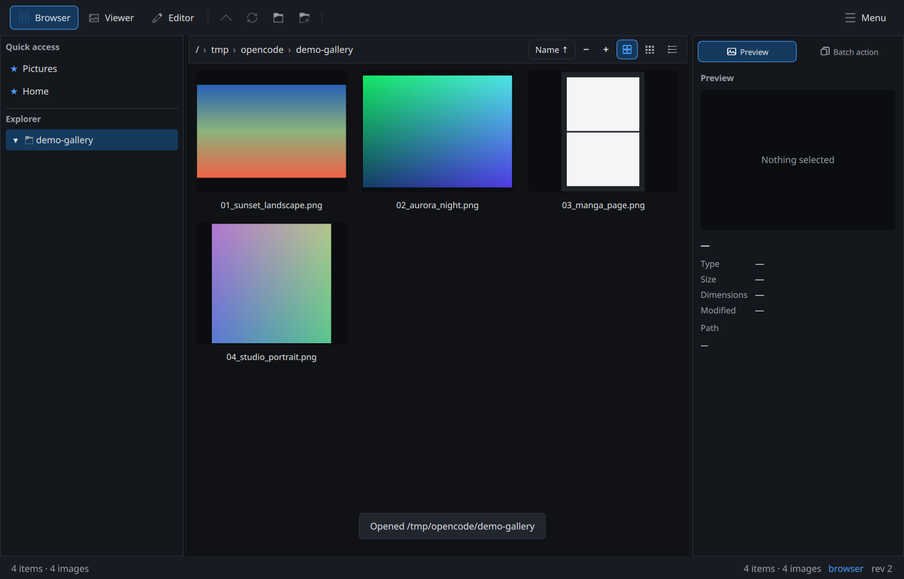
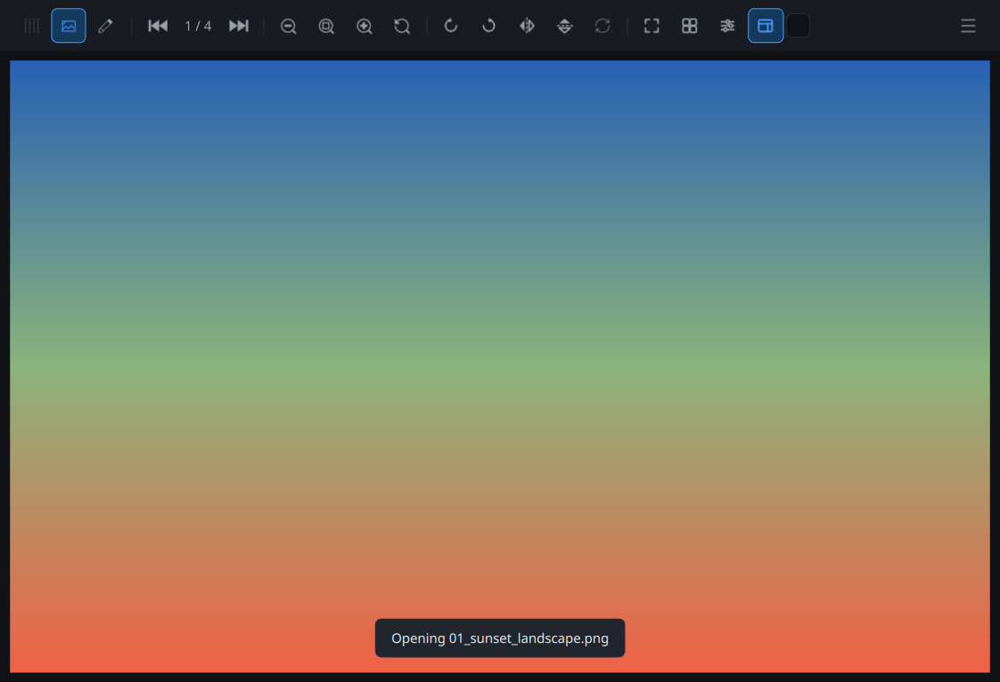
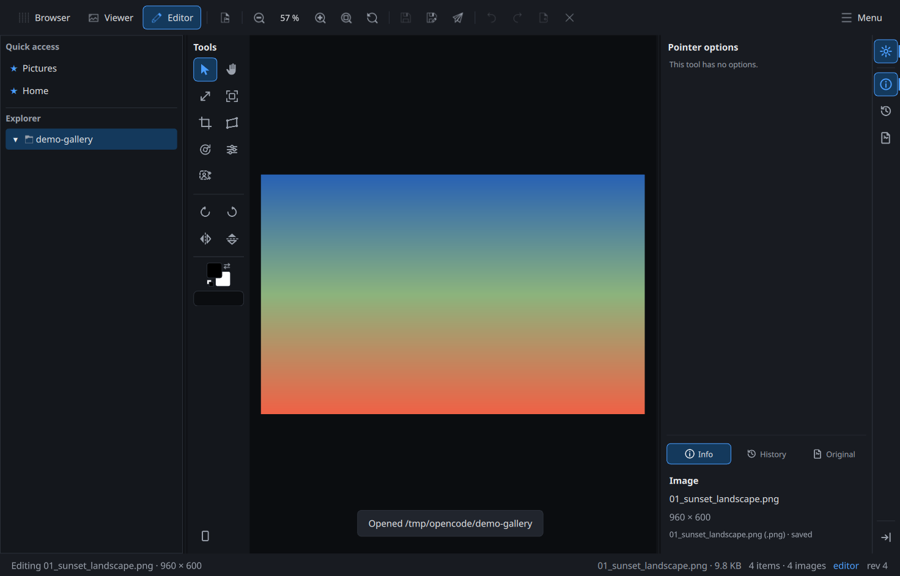
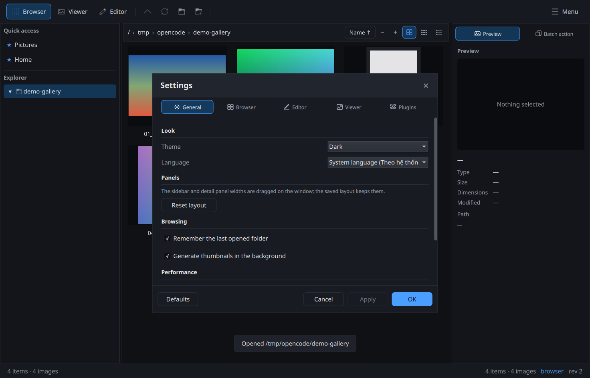

# KogaView — Fast Native Photo Manager, Manga/Webtoon Reader, Non-Destructive Editor & AI Plugin Suite

**KogaView** (`v2.0.0`) is a fast, native desktop photo manager, manga/webtoon reader, non-destructive image editor, and extensible out-of-process AI/OCR plugin platform built with **Rust** and **Qt 6 / QML** via **CXX-Qt**. Designed for Linux desktops (GNOME, KDE Plasma, Wayland/X11) with first-class **XDG Desktop Portal** and **Flatpak** readiness, every domain action flows through a single typed command gateway in Rust Core with revisioned state, structured logs, and a command journal.



---

## Highlights (v2.0.0)

### Out-of-Process Plugin Ecosystem (Zero Startup Cost)
- **Strict isolation**: Plugins run as standalone out-of-process binaries (`jsonl-stdio` protocol, [ADR 0024](docs/adr/0024-ai-plugin-architecture.md)) under `$XDG_DATA_HOME/kogaview/plugins/`. **Zero plugins or AI models are loaded at startup**; workers spawn on demand and exit automatically after each job to free RAM/VRAM.
- **6 Official Standalone Plugins** (see full reference in [**`docs/PLUGINS.md`**](docs/PLUGINS.md)):

| Plugin | Type | Capabilities & Highlights | Build Command |
|---|---|---|---|
| **Remove Background** (`kogaview-plugin-rembg`) | AI ONNX | 8 on-demand models (`isnet-general`, `isnet-anime`, `u2net`, `silueta`, `birefnet-general-lite`, `birefnet-portrait`, `u2net_human_seg`) · Editor tool + Quick Actions | `just build-plugin-rembg` |
| **AI Upscale** (`kogaview-plugin-upscale`) | AI ONNX | 2× / 4× Super-Resolution (Real-ESRGAN General & Anime 4×, Swin2SR 2×/4×) with tiled inference & alpha preservation | `just build-plugin-upscale` |
| **Image Utilities** (`kogaview-plugin-utils`) | Non-AI | Strip EXIF / GPS privacy metadata · Lossless/smart file-size optimization | `just build-plugin-utils` |
| **Offline OCR** (`kogaview-plugin-ocr`) | Tesseract | 100% offline text extraction in **5 languages** (`EN`, `JA` / `JA Vertical`, `VI`, `ZH`, `KO`) · Full-image clipboard Quick Actions + interactive region OCR + Tier-1 manga preprocessing | `just build-plugin-ocr` |
| **Read & Translate** (`kogaview-plugin-translate`) | OCR + Translate | Interactive speech-bubble & full-page translation via Tesseract + Google Translate (with auto-retry) | `just build-plugin-translate` |
| **AI OCR — Manga-OCR & RapidOCR** (`kogaview-plugin-ai-ocr`) | AI ONNX | **Manga-OCR** (ViT + BERT ONNX for Japanese manga, vertical text, furigana & screentones) + **RapidOCR** (PP-OCRv4 DBNet + SVTR for complex colored backgrounds & manhwa/manhua) | `just build-plugin-ai-ocr` |

- **Safe Quick Actions**: Right-click any image in Browser or Viewer → **Quick actions**. File-modifying actions automatically create numbered backups (`<file>~`, `<file>.2~`, `<file>.3~`) before atomically overwriting and refreshing the image.
- **Unified Settings → Plugins**: Filterable model & language pack manager (`All` · `Background` · `Upscale` · `OCR languages`) with progress bars, cancellation, delete, and local custom `.onnx` overrides.

---

### Interactive Read & Translate / Manga OCR Mode (`L`)
- **3 OCR Engines on one bar**: Switch live between **Tesseract** (lightweight, 5 languages), **Manga-OCR** (AI ONNX for Japanese manga), and **RapidOCR** (AI ONNX PP-OCRv4 for complex artwork/backgrounds).
- **2 Modes (`Translate` / `OCR only`)** + **5 Languages**: Explicit Input (`English`, `Japanese`, `Japanese (Vertical)`, `Vietnamese`, `Chinese`, `Korean`) & Output (`Vietnamese`, `English`, `Japanese`, `Chinese`, `Korean`) selectors with quick swap (`⇄`).
- **Multi-bubble workflow built for manga/comics**:
  - Drag to select multiple speech bubbles on the same page, or click **Translate page / Scan page**.
  - **Draggable bubbles & popups**: Move any bubble, the top bar, or the bottom result card freely (double-click headers to reset).
  - **Selectable text & single-language toggle**: Select and copy text directly inside every bubble and result card (`Ctrl+C`), flip each bubble between **Original** and **Translation** (1 language shown at a time), and click any bubble to inspect/retry it in the result card.
  - **Per-bubble & card Retry (`↻`)**: Re-run OCR & translation in-place whenever a network glitch occurs.
  - **Font & Size controls (`Aa`)**: Choose any system font family, switch **Auto** (60%–220% bubble-scaled) vs **Fixed** (`9–36 px`), step `A−` / `A+`, or Reset — accessible even while reading.
  - **Pan & Zoom while translating**: Scroll wheel zooms, **middle-mouse drag** or **hold `Space` + left-drag** pans smoothly in Single, Dual, and Webtoon modes (auto-hiding the floating popups while panning), with bubbles glued to exact image pixels.
  - **Review reading mode (`Review`)**: Hides both floating popups and bubble headers so you can read translated pages distraction-free with normal left-drag pan and `Space` page stepping.
  - **Auto-saved per-image sidecars**: Translations are automatically saved to `<folder>/.kogaview/translation/<filename>.json`, auto-loaded on reopen, and removable with one click (**Delete saved**).

---

### Viewer Workspace & Manga / Webtoon Reader



- **Three UI chrome modes (`M`)**: **Simple** (toolbar only, dynamic auto-fit), **Compact** (image-only with a translucent **4-edge dockable Floating HUD** with pin & magnetic snap), and **Standard** (full workspace with right Info/Color dock, filmstrip, and status bar).
- **Three image display modes**:
  - **Single**: Smooth scroll-to-zoom at cursor, double-click Fit / 100%, free pan, direct Rotate/Flip/Reset controls (`Shift+R`, `R`, `H`, `V`), and canvas background selector.
  - **Dual page (book / manga)**: Smart two-page spread pairing via fast header-only dimensions — automatic solo spreads for covers and wide landscapes, **LTR → / RTL ←** order, configurable page gap (`0 / 8 / 16 px`).
  - **Webtoon (vertical manga)**: Virtualized continuous vertical reader (`ListView` with `reuseItems` & bounded VRAM cache), 2D mouse drag-to-scroll, fast wheel scrolling (`460 px`/notch, `Shift+Wheel` turbo `900 px`), direct next/previous page jumping (`Right`/`PageDown`/`Space`), **Smart Auto-Fit** (`Auto` / `Width` / `Height` / `100%`), and full **OCR / Translate region mapping** across pages.
- **Fullscreen (`F11`)** & **View-only Light & Color adjustments** (60 fps GPU preview, never written to disk).

---

### Browser Workspace
- **Async background folder scanning & disk-cached thumbnails**: Bounded worker pool (`ThumbnailCache`) with instant synchronous cache hits, LRU disk eviction, and EXIF orientation support.
- **Three view modes & 5 thumbnail sizes**: **Thumbnails**, **Icons**, and **Details** views (`XS`, `S`, `M`, `L`, `XL`).
- **Sorting, Quick Access & Batch processing**: Batch **Resize**, **Crop** (3×3 anchor grid, `px`/`%`, aspect ratios), and **Convert** with progress, cancellation, and safe non-overwriting defaults.

---

### Editor Workspace (Non-Destructive)



- **Non-destructive pipeline**: Originals are never overwritten until explicitly saved (with automatic backup on overwrite), full **Undo / Redo / Reset** history, **Close editor** button, and safe unsaved-changes Save/Discard guards when switching images or workspaces.
- **Tools**: Pointer & Hand (`H` / `Space` + Drag), **Resize**, **Canvas Size**, **Crop**, **Transform**, **Rotate by angle**, **Color & Light**, and **AI Remove Background** (when `kogaview-plugin-rembg` is installed).
- **App-themed Color Picker** with XDG Desktop Portal **Screen Eyedropper** (`org.freedesktop.portal.Screenshot.PickColor`) and native Portal **Export / Save As** dialogs (PNG, JPEG, WebP, TIFF, GIF, BMP, TGA, QOI).

---

### Desktop, Settings & Localization



- **Compact 5-tab Settings dialog** (`General`, `Browser`, `Editor`, `Viewer`, `Plugins`) responsive down to narrow windows.
- **Light & Dark themes** with synchronized Qt Fusion palette.
- **Bilingual UI**: English (`en`) and Vietnamese (`vi`), switchable live in Settings.

---

## Quick Start

### Prerequisites
- **Rust** (stable toolchain, `cargo`)
- **CMake** ≥ 3.24 & **Ninja** (or Make)
- **Qt 6** (`Core`, `Gui`, `Qml`, `Quick`, `QuickControls2`, `QuickEffects`, `DBus`, `LinguistTools`)
- **just** (`justfile` task runner) and **Python 3**
- Optional for OCR/Translate plugins: `tesseract` and `curl`

### Build, Test, Install & Build Plugins

```sh
just setup           # verify toolchain and Qt 6 dependencies
just build           # configure + build dev binary (build/dev/bin/kogaview)
just run             # build and launch the dev app
just test            # run Rust workspace, translation, packaging, and QML suites
just install         # build optimized release and install to /usr/local
just install-dev     # build optimized dev-prod with dev hooks and install
just build-plugins   # build & install all 6 optional plugins to ~/.local/share/kogaview/plugins/
just uninstall       # remove installed binary and desktop integration
just doctor          # inspect versions, app identity, and environment
```

Or build individual plugins as needed:

```sh
just build-plugin-rembg
just build-plugin-upscale
just build-plugin-utils
just build-plugin-ocr
just build-plugin-translate
just build-plugin-ai-ocr
```

CLI usage:

```sh
kogaview open /path/to/photo.jpg
kogaview open-folder ~/Pictures
kogaview --version
```

---

## Architecture

- **Core (`crates/app-core`, `crates/app-editor`, `crates/app-protocol`)**: Qt-independent Rust modular monolith owning domain state, typed `Envelope` command gateway, non-destructive image pipeline, batch jobs, plugin host & on-demand model manager, translation sidecars, config persistence, structured tracing logs, and command journal.
- **Desktop Adapter & UI (`crates/desktop`, `cpp/`)**: CXX-Qt bridge, C++ `ThumbnailCache` & `PlatformHelper` (XDG Desktop Portal FileChooser, Screenshot.PickColor, OpenURI), and Qt 6 / QML views (`BrowserView`, `Viewer`, `ViewerWebtoonView`, `ViewerTranslateOverlay`, `EditorView`).
- **Plugins (`plugins/*`)**: Independent Rust workspaces speaking `jsonl-stdio`, installed under `$XDG_DATA_HOME/kogaview[-dev]/plugins/`.

### Runtime Identity

| | Dev build | Production build |
|---|---|---|
| Name | KogaView (Dev) | KogaView |
| App ID | `io.github.tienv2i.KogaView.Dev` | `io.github.tienv2i.KogaView` |
| Config | `~/.config/kogaview-dev/config.json` | `~/.config/kogaview/config.json` |
| Data & Plugins | `~/.local/share/kogaview-dev/` | `~/.local/share/kogaview/` |
| State & Logs | `~/.local/state/kogaview-dev/` | `~/.local/state/kogaview/` |
| Cache | `~/.cache/kogaview-dev/` | `~/.cache/kogaview/` |

---

## Documentation

- [**`docs/PLUGINS.md`**](docs/PLUGINS.md) — Complete guide to all 6 plugins, models, OCR/Translate workflow & plugin authoring
- [`docs/PRD.md`](docs/PRD.md) — Product requirements
- [`docs/ARCHITECTURE.md`](docs/ARCHITECTURE.md) — Core/UI split, command bus, persistence
- [`docs/UI-DESIGN-SYSTEM.md`](docs/UI-DESIGN-SYSTEM.md) — UI/UX design system & Qt 6 QML engineering rules
- [`docs/WORKSPACES.md`](docs/WORKSPACES.md) — Browser, Viewer, and Editor routing
- [`docs/BUILD.md`](docs/BUILD.md) — Build, run, and install contract
- [`docs/CLI.md`](docs/CLI.md) — CLI launch surface
- [`docs/FLATPAK.md`](docs/FLATPAK.md) — Sandbox and portal constraints
- [`docs/adr/`](docs/adr/) — Architecture Decision Records (including [ADR 0024: AI Plugin Architecture](docs/adr/0024-ai-plugin-architecture.md))

## License

MIT — see [`LICENSE`](LICENSE).
